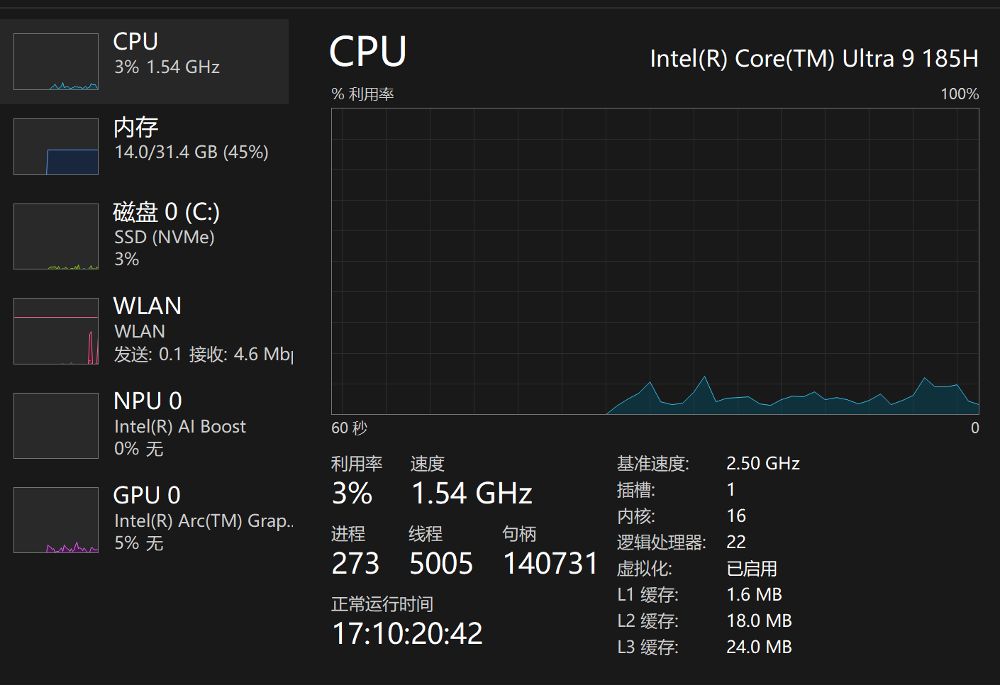

# CEPARCO_SIMD 

## 👥 Group Members 
*   **COPON, MATTHEW JOSHUA**
*   **LEE, ASHLEY FIONA SANTOS**
*   **ONG, EIRESS BASSEY HAO**
*   **XU, KAI WEN**

### Documentation

The maximum input size was selected as 2^28 because the system has 31.4 GB of usable RAM, with approximately 17.4 GB available during testing. Since ten arrays of 4-byte floating-point elements require approximately 10 GiB at this input size, it provides sufficient memory headroom for the experiment while minimizing the risk of allocation failure or excessive memory swapping.

If 2^29 selected:
Ten arrays of 4-byte floating-point elements require approximately 20 GiB of memory, exceeding the approximately 17.4 GB of available RAM during testing. Therefore, this input size may cause memory allocation failures or excessive memory swapping.

If 2^30 selected :
Ten arrays of 4-byte floating-point elements require approximately 40 GiB of memory. This exceeds the system's total usable RAM of 31.4 GB, making it impractical to allocate all arrays simultaneously and increasing the likelihood of memory allocation failures.

<br>

**Execution Time Comparison**

Debug mode is meant for development. The compiler applies no optimizations and keeps debugging information, so the programmer can pause execution at breakpoints, inspect variable values, and step through the code line by line.

Release mode is meant for deployment. The compiler applies maximum optimizations and may rewrite inefficient or unnecessary code when generating machine code. Examples include keeping variables in registers instead of memory, reordering or merging statements, removing dead code, and hoisting loop-invariant code. As a result, the program generally runs faster and uses less memory.

<br>

**Release Build**
| Vector Size (n) | C Implementation | x86-64 Implementation | SIMD XMM | SIMD YMM |
|:---:|:---:|:---:|:---:|:---:|
| **2^20** | 1.73 ms | 0.79 ms | 0.39 ms | 0.38 ms |
| **2^26** | 113.15 ms | 64.05 ms | 47.06 ms | 46.43 ms |
| **2^28** | 472.15 ms | 333.72 ms | 235.54 ms | 220.27 ms |
| **Geometric Mean vs C** | 1 | 0.57 | 0.36 | 0.35 |
| **Speed up vs C** | - | 1.75× | 2.78x | 2.86x |
| **Boundary (n=1003)** | <0.01 ms | < 0.01 ms | < 0.01 ms | < 0.01 ms |

In Release mode, AVX2 YMM is the fastest overall, with a 2.86× speedup over C, followed by XMM at 2.78× and x86-64 at 1.75×. YMM processes 8 floats per instruction, while XMM processes 4, allowing YMM to handle more elements per iteration. However, the performance difference between the two SIMD kernels is small, and the speedup does not reach the theoretical 4× or 8× limits because loading and storing large amounts of data also takes time, which offsets the benefits of wider registers.

<br>

**Debug Build**
| Vector Size (n) | C Implementation | x86-64 Implementation | SIMD XMM | SIMD YMM |
|:---:|:---:|:---:|:---:|:---:|
| **2^20** | 2.07 ms | 0.87 ms | 0.37 ms | 0.47 ms |
| **2^26** | 106.49 ms | 84.08 ms | 58.12 ms | 68.23 ms |
| **2^28** | 530.53 ms | 264.07 ms | 226.36 ms | 231.47 ms |
| **Geometric Mean Speedup vs C** | 1 | 0.55 | 0.35 | 0.40 |
| **Speedup vs C** | — | 1.82x | 2.86x | 2.50x |
| **Boundary (n=1003)** | < 0.01 ms | < 0.01 ms | < 0.01 ms | < 0.01 ms |

In Debug mode, SIMD XMM is the fastest overall, reaching 2.86× speedup over C, followed by YMM at 2.50× and x86-64 at 1.82×. XMM is faster than YMM in all three tested sizes, likely because YMM's wider registers do not provide enough benefit to offset their overhead in these tests. Furthermore, This is because the kernel is memory-bandwidth-bound: at these sizes the arrays do not fit in cache, so performance is limited by how fast data can be read from memory rather than by how many elements each instruction processes essentially memory-bounded bottleneck most likely due to the host's computer specifications. The gap narrows to about 2% at the largest size, where both kernels are limited by DRAM bandwidth. Both SIMD kernels outperform C by processing multiple elements per instruction, while x86-64 benefits from using registers directly.

<br>

**Release vs Debug**
| Vector Size (n) | Release | Debug |
|:---:|:---:|:---:|
| **x86-64** | 1.75x | 1.82x |
| **SIMD XMM** | 2.78x | 2.86x |
| **SIMD YMM** | 2.86x | 2.50x |

The speedups in the table are measured against the C kernel, which is the only kernel whose code changes between Debug and Release builds. The assembly kernels are assembled by NASM, so their machine code is identical in both builds. In Debug, the C reference is unoptimized, so it runs slower, which raises the speedup of every kernel relative to Release. This matches the x86-64 and XMM results (1.75x to 1.82x and 2.78x to 2.86x). YMM moved the other way (2.86x to 2.50x), so something else outweighed the C effect. Since the YMM code is identical in both builds, this is likely due to run-to-run variation.

<br>

- **Test Setup**
```c
void generate_random_array(float* A, float* B, int size) {
    for (int i = 0; i < size; i++) {
        A[i] = sinf(i * 0.001f);
        B[i] = cosf(i * 0.002f);
    }
}
```
Arrays A and B are generated using sinf() and cosf(), where A[i] = sinf(i * 0.002f) and B[i] = cosf(i * 0.001f). Each kernel compares the values and stores the larger one in C[i]. The idx[i] is set to 0 if A[i] is greater than or equal to B[i], and 1 otherwise. Timing only covers kernel execution, excluding array initialization and result printing. Each kernel runs 30 times, and the average execution time is recorded for both Debug and Release builds. All tests use x64 mode with AVX2 enabled, with array sizes of 2²⁰, 2²⁶, 2²⁸, and 1003 for the boundary case.

<br>

- **Correctness Check**

The C version was used as the answer key. The first 5 and last 5 elements were displayed, and all elements of each kernel's output were compared against the C output.

| Kernel | Result |
|:---:|:---:|
| x86-64 | Correct/Passed |
| SIMD XMM | Correct/Passed |
| SIMD YMM | Correct/Passed |

<br>

- **Boundary Handling**

An array size of 1003 was used to test how the SIMD kernels handle elements that do not fill a complete vector. Since 1003 is not divisible by 4 or 8, both kernels have 3 remaining elements after processing their full blocks.

  - XMM (4-wide): Processes 250 blocks of 4 elements, then handles the remaining 3 elements individually.

  - YMM (8-wide): Processes 125 blocks of 8 elements, then handles the remaining 3 elements individually.

Result: The first and last 5 elements match the C reference for all kernels [(see images)](#output). This shows that both SIMD kernels correctly process the leftover elements and produce the expected results for an array size that is not a multiple of their vector widths.

<br>

- **Problems Encountered and Solutions**

**Challenge 1: Indexing through arrays A and B**

One of the challenges the group faced was figuring out how to **index** through arrays A and B, especially for the **packed single-precision** values in the XMM and YMM registers.

**Solution:** The group used an **indexing register** that increments by `4` for XMM and by `8` for YMM. These values represent the number of 32-bit single-precision numbers that each register can hold. The index is then multiplied by `4`, since a single-precision floating-point number takes **4 bytes**.

**Moment of realization:** Although confusing at first, the group realized that the index can be used to count **elements**, while a fixed constant can be used to represent the **number of bytes** of each number. Multiplying them gives the total number of bytes to index or skip through for each loop iteration.

<br>

**Challenge 2: Vector sizes not divisible by 4 or 8**

The next challenge was handling vector sizes of A and B that are **not divisible** by 4 (XMM) or 8 (YMM).

**Solution (remainder):** The group used `AND EAX, 0x0003` (or `0x0007` for YMM) to retrieve the **remainder**. After this instruction, `EAX` holds only the remainder, since the lowest 2 bits (or 3 bits for YMM) of the vector size are the remainder when dividing by 4 (or 8).

**Solution (loop count):** The vector size must also be divided by 4 or 8 to get the new **loop count**. This was done with `SHR R10D, 2` (or `SHR R10D, 3` for YMM), where `R10D` holds the vector size before the shift and the loop count after it.

**Moment of realization:** Since 4 and 8 are powers of 2, the **remainder** and the **quotient** can be found with a bitwise `AND` and a right shift which is the same as performing division.

<br>

**Challenge 3: Learning the packed instructions for XMM and YMM**

The group had to learn and refresh on the **packed instructions** for the XMM and YMM registers. These were needed to perform **value comparisons** between two arrays using `VCMPPS` and `VMAXPS`, and **bit shifting** using `VPSRLD`.

**Solution:** These instructions target all 4 values (XMM) or all 8 values (YMM) **at the same time in one line**. This avoids unnecessary loops and increased efficiency.

**Moment of realization:** One packed instruction replaces a whole loop over the individual elements, which is the main benefit of **SIMD**.

<br>

<a id="output"></a>
- **Program Execution Output**
Refer to the images below for the benchmark results:

### Debug Build

| Input Size | C (1) | ASM x64 (2) | AVX2 XMM (3) | AVX2 YMM (4) |
|:---:|:---:|:---:|:---:|:---:|
| 2^20 | .png) | .png) | .png) | .png) |
| 2^26 | .png) | .png) | .png) | .png) |
| 2^28 | .png) | .png) | .png) | .png) |

### Release Build

| Input Size | C (1) | ASM x64 (2) | AVX2 XMM (3) | AVX2 YMM (4) |
|:---:|:---:|:---:|:---:|:---:|
| 2^20 | .png) | .png) | .png) | .png) |
| 2^26 | .png) | .png) | .png) | .png) |
| 2^28 | .png) | .png) | .png) | .png) |

### Boundary Test Case (1003 Elements)

#### Debug Build

| C (1) | ASM x64 (2) | AVX2 XMM (3) | AVX2 YMM (4) |
|:---:|:---:|:---:|:---:|
| .png) | .png) | .png) | .png) |

#### Release Build

| C (1) | ASM x64 (2) | AVX2 XMM (3) | AVX2 YMM (4) |
|:---:|:---:|:---:|:---:|
| .png) | .png) | .png) | .png) |
