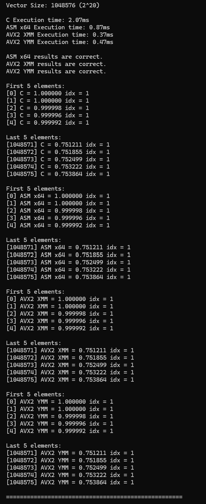
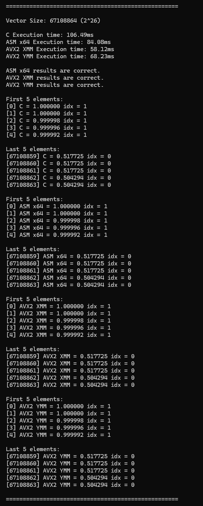
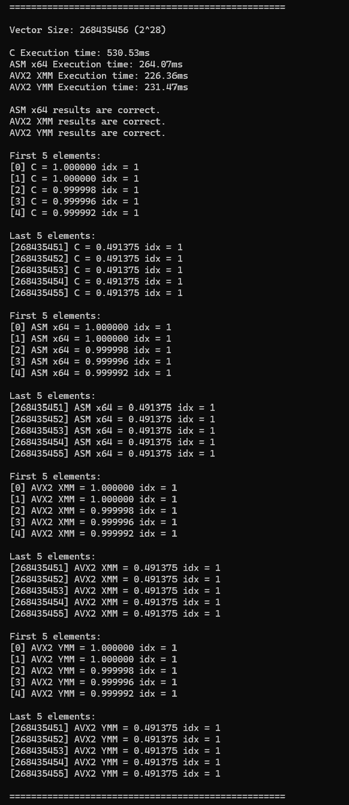
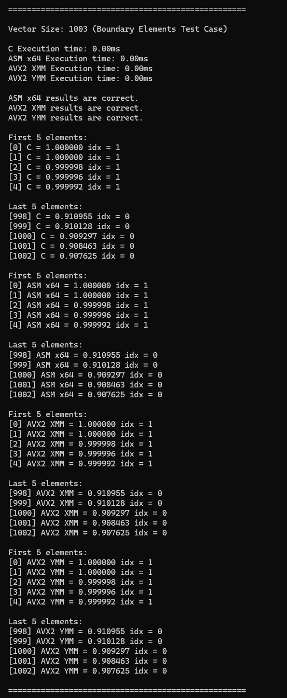
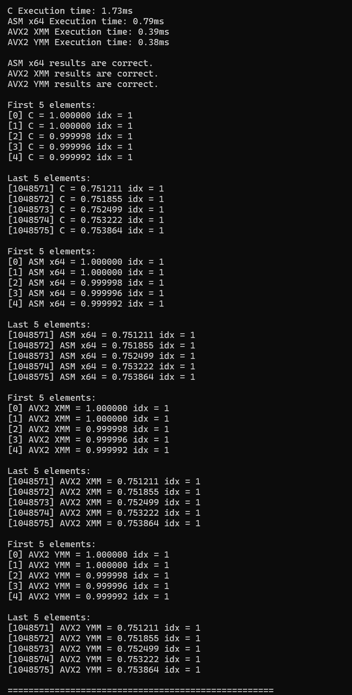
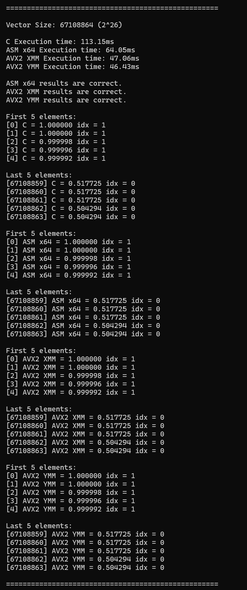
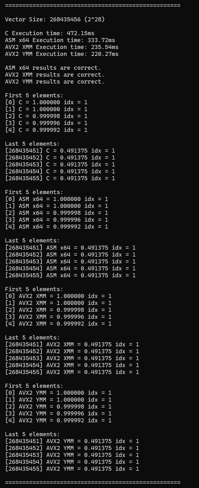
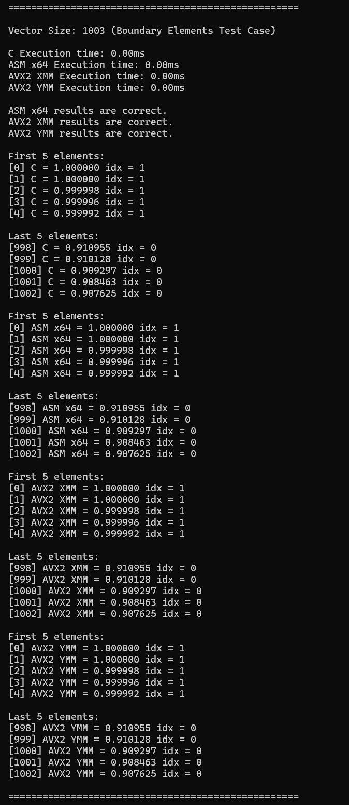

# PARCO_MCO1

## 👥 Group Members 
*   **COPON, MATTHEW JOSHUA**
*   **LEE, ASHLEY FIONA SANTOS**
*   **ONG, EIRESS BASSEY HAO**
*   **XU, KAI WEN**

## Documentation
 **Execution Time Comparison**

**Release Build**
| Vector Size (n) | C Implementation | x86-64 Implementation | SIMD XMM | SIMD YMM |
|:---:|:---:|:---:|:---:|:---:|
| **2^20** | 1.73 ms | 0.79 ms | 0.39 ms | 0.38 ms |
| **2^26** | 113.15 ms | 64.05 ms | 47.06 ms | 46.43 ms |
| **2^30** | 472.15 ms | 333.72 ms | 235.54 ms | 220.27 ms |
| **Geometric Mean vs C** | 1 | 0.57 | 0.36 | 0.35 |
| **Speed up vs C** | - | 1.75× | 2.78x | 2.86x |
| **Boundary (n=1003)** | <0.01 ms | < 0.01 ms | < 0.01 ms | < 0.01 ms |

AVX2 YMM is the fastest across all array sizes, with up to 4.5× speedup over pure C, followed closely by XMM at 4.4×. YMM processes 8 floats per instruction, while XMM processes 4, allowing YMM to handle more elements per iteration. The x86-64 assembly is also faster than pure C by 1.88× because it uses registers directly and avoids unnecessary instructions. However, the speedup does not reach the theoretical 4× or 8× limits because large arrays are memory-bound. Loading and storing data takes up a significant amount of time, limiting the benefits of wider registers.

**Debug Build**
| Vector Size (n) | C Implementation | x86-64 Implementation | SIMD XMM | SIMD YMM |
|:---:|:---:|:---:|:---:|:---:|
| **2^20** | 2.07 ms | 0.87 ms | 0.37 ms | 0.47 ms |
| **2^26** | 106.49 ms | 84.08 ms | 58.12 ms | 68.23 ms |
| **2^28** | 530.53 ms | 264.07 ms | 226.36 ms | 231.47 ms |
| **Geometric Mean Speedup vs C** | 1 | 0.55 | 0.35 | 0.40 |
| **Speedup vs C** | — | 1.82x | 2.86x | 2.50x |
| **Boundary (n=1003)** | < 0.01 ms | < 0.01 ms | < 0.01 ms | < 0.01 ms |

In Debug mode, SIMD XMM is the fastest overall, reaching 2.86× speedup over C, followed by YMM at 2.50× and x86-64 at 1.82×. XMM is faster than YMM in all three tested sizes, likely because YMM's wider registers do not provide enough benefit to offset their overhead in these tests. Both SIMD kernels outperform C by processing multiple elements per instruction, while x86-64 benefits from using registers directly.

<br>

- **Test Setup**
```c
void generate_random_array(float* A, float* B, int size) {
    for (int i = 0; i < size; i++) {
        A[i] = sinf(i * 0.002f);
        B[i] = cosf(i * 0.001f);
    }
}
```
Arrays A and B are generated using sinf() and cosf(), where A[i] = sinf(i * 0.002f) and B[i] = cosf(i * 0.001f). Each kernel compares the values and stores the larger one in C[i]. The idx[i] is set to 0 if A[i] is greater than or equal to B[i], and 1 otherwise. Timing only covers kernel execution, excluding array initialization and result printing. Each kernel runs 30 times, and the average execution time is recorded for both Debug and Release builds. All tests use x64 mode with AVX2 enabled, with array sizes of 2²⁰, 2²⁶, 2²⁸, and 1003 for the boundary case.

<br>

- **Correctness Check**

The C version was used as the answer key. The first 5 and last 5 elements were displayed, and all elements of each kernel's output were compared against the C output.

| Kernel | Result |
|:---:|:---:|
| x86-64 | Correct/Passed |
| SIMD XMM | Correct/Passed |
| SIMD YMM | Correct/Passed |

<br>

- **Boundary Handling**

An array size of 1003 was used to test how the SIMD kernels handle elements that do not fill a complete vector. Since 1003 is not divisible by 4 or 8, both kernels have 3 remaining elements after processing their full blocks.

  - XMM (4-wide): Processes 250 blocks of 4 elements, then handles the remaining 3 elements individually.

  - YMM (8-wide): Processes 125 blocks of 8 elements, then handles the remaining 3 elements individually.

Result: The first and last 5 elements match the C reference for all kernels [(see images)](#output). This shows that both SIMD kernels correctly process the leftover elements and produce the expected results for an array size that is not a multiple of their vector widths.

<br>

- **Problems Encountered and Solutions**

**Challenge 1: Indexing through arrays A and B**

One of the challenges the group faced was figuring out how to **index** through arrays A and B, especially for the **packed single-precision** values in the XMM and YMM registers.

**Solution:** The group used an **indexing register** that increments by `4` for XMM and by `8` for YMM. These values represent the number of 32-bit single-precision numbers that each register can hold. The index is then multiplied by `4`, since a single-precision floating-point number takes **4 bytes**.

**Moment of realization:** Although confusing at first, the group realized that the index can be used to count **elements**, while a fixed constant can be used to represent the **number of bytes** of each number. Multiplying them gives the total number of bytes to index or skip through for each loop iteration.

<br>

**Challenge 2: Vector sizes not divisible by 4 or 8**

The next challenge was handling vector sizes of A and B that are **not divisible** by 4 (XMM) or 8 (YMM).

**Solution (remainder):** The group used `AND EAX, 0x0003` (or `0x0007` for YMM) to retrieve the **remainder**. After this instruction, `EAX` holds only the remainder, since the lowest 2 bits (or 3 bits for YMM) of the vector size are the remainder when dividing by 4 (or 8).

**Solution (loop count):** The vector size must also be divided by 4 or 8 to get the new **loop count**. This was done with `SHR R10D, 2` (or `SHR R10D, 3` for YMM), where `R10D` holds the vector size before the shift and the loop count after it.

**Moment of realization:** Since 4 and 8 are powers of 2, the **remainder** and the **quotient** can be found with a bitwise `AND` and a right shift which is the same as performing division.

<br>

**Challenge 3: Learning the packed instructions for XMM and YMM**

The group had to learn and refresh on the **packed instructions** for the XMM and YMM registers. These were needed to perform **value comparisons** between two arrays using `VCMPPS` and `VMAXPS`, and **bit shifting** using `VPSRLD`.

**Solution:** These instructions target all 4 values (XMM) or all 8 values (YMM) **at the same time in one line**. This avoids unnecessary loops and increased efficiency.

**Moment of realization:** One packed instruction replaces a whole loop over the individual elements, which is the main benefit of **SIMD**.

<br>

<a id="output"></a>
- **Program Execution Output**

Refer to the images below for the benchmark results:
### Debug Build
| 2²⁰ | 2²⁶ | 2²⁸ | Boundary 1003 |
|:---:|:---:|:---:|:---:|
|  |  |  |  |

### Release Build
| 2²⁰ | 2²⁶ | 2²⁸ | Boundary 1003 |
|:---:|:---:|:---:|:---:|
|  |  |  |  |
